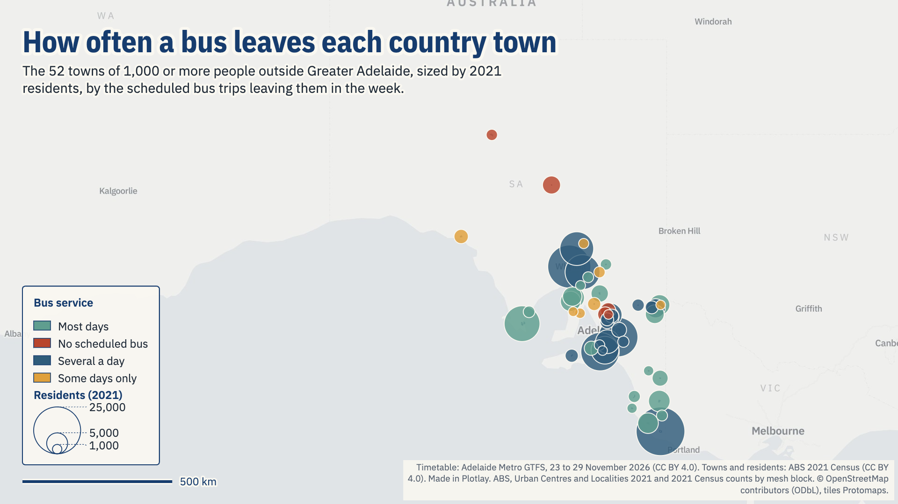

# South Australia's country towns: how many buses a week?

Which South Australian country towns have a regular bus, and how many buses a week reach them? The 52 towns of 1,000 or more people outside Greater Adelaide, counted from the state's public transport timetable for one week. Made with [Plotlay](https://www.getplotlay.com): the showcase page is [getplotlay.com/showcase/sa-country-buses](https://www.getplotlay.com/showcase/sa-country-buses/) and the project opens in the app at [app.plotlay.io/?example=sa-country-buses](https://app.plotlay.io/?example=sa-country-buses).

## What it shows

In the week of Monday 23 to Sunday 29 November 2026, on the published timetable:

- **12 of the 52 towns, with 21,380 residents, have a bus on four days of the week or fewer.** 5 of them (11,284 residents) have no scheduled bus at all: Kapunda, Freeling and Greenock have school buses only, and Roxby Downs and Coober Pedy have no service in the feed.
- 19 towns (65,821 residents) have a bus on five or more days but fewer than four trips a day on average; 21 (156,198) have several a day.
- 26 of the 52 have a bus every weekday that goes on to Greater Adelaide.
- Trips leaving the 52 towns: 433 on the Monday, 461 on the Friday, 155 on the Saturday and 114 on the Sunday (2,428 in the week). Whyalla alone has a quarter of the weekday trips, most of them its town buses.
- Port Lincoln, with 14,410 residents, has 5 trips in the week: one coach on five days.

The towns with a bus on four days or fewer:

| Town | Residents (2021) | Trips in the week | Days with a bus | Days |
|---|---|---|---|---|
| Roxby Downs | 3,668 | 0 | 0 | nothing in the feed |
| Kapunda | 2,611 | 0 | 0 | school buses only |
| Freeling | 2,528 | 0 | 0 | school buses only |
| Coober Pedy | 1,435 | 0 | 0 | nothing in the feed |
| Greenock | 1,042 | 0 | 0 | school buses only |
| Ceduna | 2,280 | 2 | 2 | Tue, Fri |
| Quorn | 1,152 | 2 | 1 | Fri |
| Balaklava | 1,966 | 4 | 2 | Mon, Fri |
| Paringa | 1,031 | 4 | 2 | Wed, Fri |
| Jamestown | 1,404 | 8 | 3 | Mon, Fri, Sun |
| Maitland | 1,075 | 8 | 3 | Wed, Fri, Sun |
| Ardrossan | 1,188 | 10 | 4 | Mon, Wed, Fri, Sun |

## Method

1. **Towns**: the ABS Urban Centres and Localities (2021) in South Australia whose mesh blocks lie outside Greater Adelaide, with residents summed from the 2021 Census mesh block counts (a mesh block counts in the town its point falls in). 52 have 1,000 or more residents: 243,399 people in all.
2. **The timetable**: Adelaide Metro's GTFS feed (version 1721), which carries the state's country coaches and town buses (Stateliner, LinkSA, Des's Transport, BusBiz, Peninsula Coaches, Southlink Country, Community Care and Transport, SeaLink) as well as Adelaide's network. Each day of Monday 23 to Sunday 29 November 2026 read whole, 03:00 to 27:00, buses only.
3. **A trip counts for a town** when it picks up at a stop inside the town or within 400 m of its edge (a straight line), at a stop that is not its last. Each trip counts once a day however many of its stops are in the town. School services (routes whose description says so) and demand responsive services are left out and counted separately.
4. **Classes**: No scheduled bus (no trip in the week); Some days only (a trip on 1 to 4 days); Most days (5 or more days, fewer than 4 trips a day on average); Several a day.
5. **On to Greater Adelaide**: a trip that stops inside Greater Adelaide (ABS Greater Capital City area) after leaving the town.

The figures were worked out in Plotlay (the public transport card's Through a week, and the connector's `service_week`) and again, independently, in pandas from the GTFS text files (`town_trips.csv`): all 52 towns agree.

## Read it carefully

- **Timetable, not what ran.** The week is as published in the feed; nothing here about cancellations, late running or how full the buses were.
- **What is not in the feed.** Interstate coaches (Greyhound, which serves Coober Pedy on its Adelaide to Alice Springs route, and V/Line's coaches into the South East), council and community buses not listed in the feed, flights and most ferries are not counted. A town shown with no scheduled bus may still have one of these.
- **Bookings.** Many country coaches must be booked ahead; a trip in the timetable may still need a phone call.
- **School buses** are left out because most are for students only. Kapunda, Freeling and Greenock have school services in the feed and nothing else.
- **A straight 400 m.** A stop counts when it is within 400 m of the town's edge in a straight line, not along a road.
- **One week.** 23 to 29 November 2026 is a school-term week with no public holiday in South Australia. School holidays and holiday weekends differ.
- **Residents in 2021.** Census counts by usual address in August 2021.

## In this repository

- `data/tables/`: `towns.csv` (each town: residents, class, trips by day, days with a bus, trips on to Greater Adelaide, school trips, routes and operators), `town_trips.csv` (one row per trip, town and day, with its route, operator and kind), `town_stops.csv` (the stops in or within 400 m of each town), `classes.csv`, `days.csv`.
- `data/geometry/`: the towns as exported from Plotlay (GeoJSON, TopoJSON, CSV with WKT) and Greater Adelaide's outline.
- `python/sa_country_buses.ipynb`: a narrated notebook that recomputes every number here from `town_trips.csv`.
- `powerbi/`: a Power BI Project (`.pbip`); see `powerbi/OPEN-ME.md`.
- `visuals/`: the charts and map pictures, made in Plotlay.

## Sources and licences

- Department for Infrastructure and Transport, [Adelaide Metro General Transit Feed](https://data.sa.gov.au/data/dataset/https-gtfs-adelaidemetro-com-au) (GTFS, feed version 1721), Data.SA, CC BY 4.0.
- Australian Bureau of Statistics, 2021 Census Mesh Block Counts, ASGS Edition 3 mesh blocks, Urban Centres and Localities 2021 and Greater Capital City Statistical Areas 2021, CC BY 4.0.

Our tables, the town shapes and the visuals are CC BY 4.0 ([LICENSE-DATA](LICENSE-DATA)); the code is MIT ([LICENSE](LICENSE)). Details in [NOTICE](NOTICE). Independent work using open data, not endorsed by the Department for Infrastructure and Transport or the ABS.
